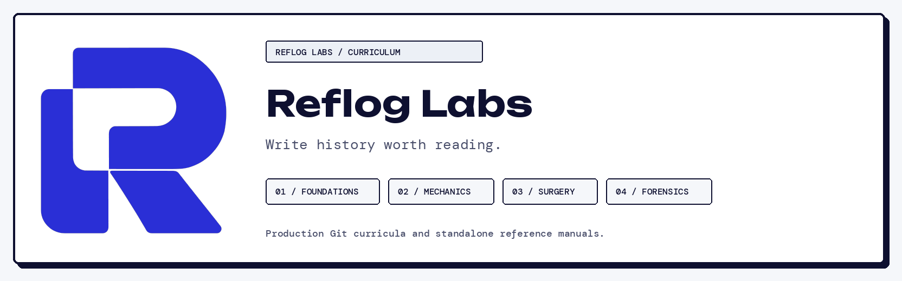
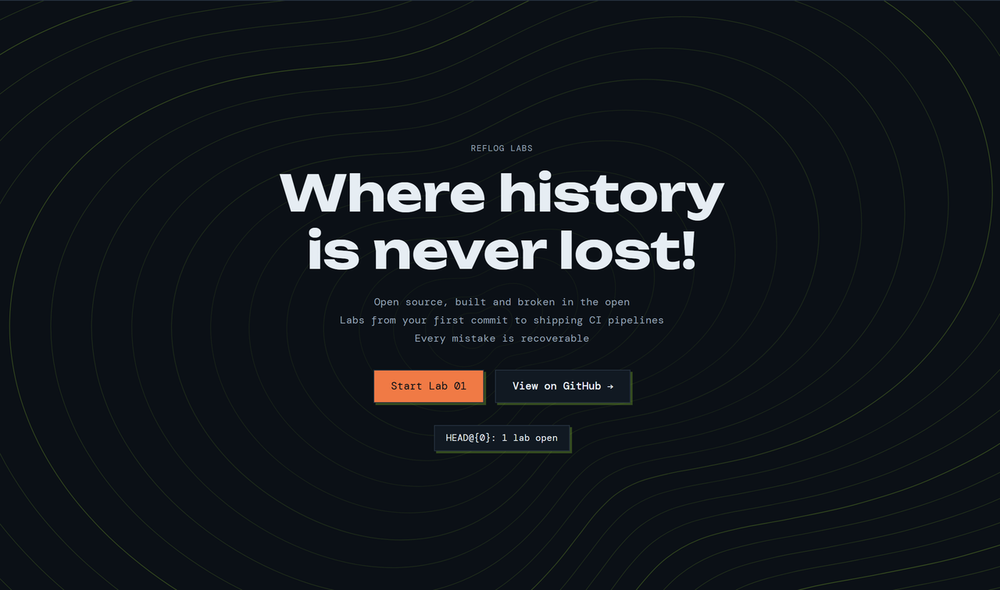
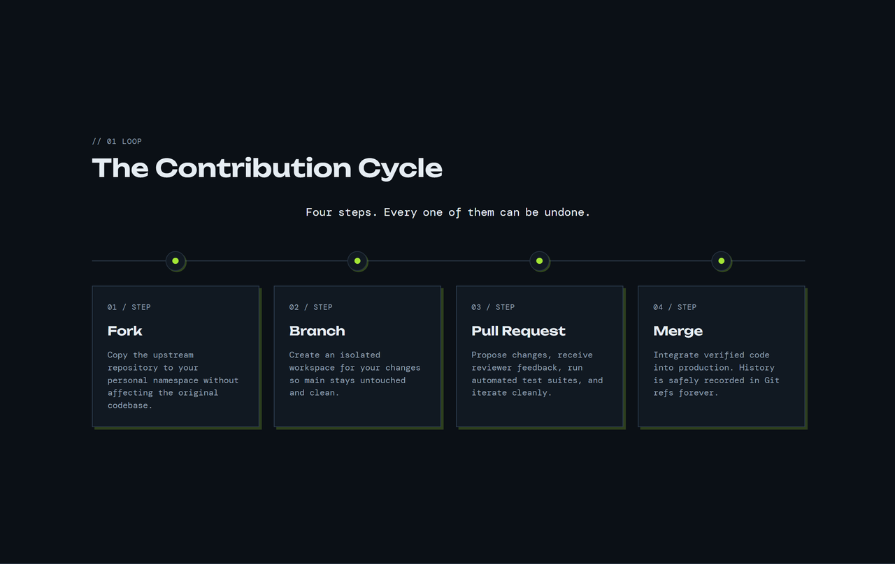
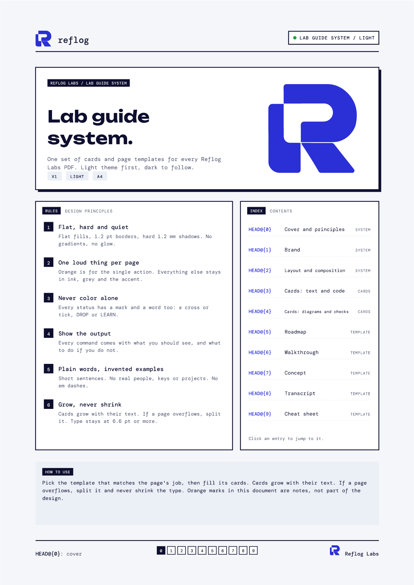

<picture>
  <source media="(prefers-color-scheme: dark)" srcset="assets/org-banner-dark.png">
  
</picture>

  

**Production Git curricula teaching engineers how version control operates under real-world constraints.**

[Interactive Website](https://refloglabs.github.io) &nbsp;&bull;&nbsp; [Curriculum Catalog](https://github.com/orgs/ReflogLabs/repositories) &nbsp;&bull;&nbsp; [Design Standards](https://refloglabs.github.io)

 

---

## Pedagogical Philosophy

Most Git tutorials present version control as a personal backup utility. In distributed engineering teams, your Git history is your team communication log, forensic timeline, and release baseline. Reflog Labs provides structured modules and standalone reference manuals centered on four core tenets:

1. **Semantic Atomicity**: Every commit represents a single logical unit of change with an explicit rationale, not an arbitrary checkpoint.
2. **Plumbing Comprehension**: Deep understanding of references, object hashing, tree structures, and index states so recovery becomes second nature.
3. **Operational Truth**: Every practice scenario generates real terminal outputs, real commit hashes, and real merge dynamics.
4. **Permanent Reference**: Standalone 9-page vector manuals typeset in dual themes (print-ready light and screen-optimized dark) with fillable AcroForm checklists.

---

## Curriculum Structure

| Module | Status | Topic Focus | Repository |
|---|---|---|---|
| **01 / First Commit** | **Active** | Core config, history inspection, pickaxe search (`git log -S`), `.gitignore` defense, and atomic 50/72 staging. | [Link](https://github.com/ReflogLabs/lab-01-first-commit) |
| **02 / Branching Mechanics** | *Planned* | Graph topology, pointer kinematics, fast-forward versus three-way merge commits, and remote tracking branches. | Soon |
| **03 / History Surgery** | *Planned* | Interactive rebase (`git rebase -i`), squash, reword, drop, and resolving conflicting semantic patches cleanly. | Soon |
| **04 / Forensics and Recovery** | *Planned* | Diagnosing lost commits via `git reflog`, detached HEAD salvage, dangling object recovery, and index repairs. | Soon |

---

## Platform Overview

  

 

  

 

---

## Typesetting and Design System

Reflog Labs manuals are engineered using a bespoke Python and ReportLab typography engine:

- **Strict Grid System**: 12-column responsive layout built to fit ISO 216 paper geometry.
- **Accessible Contrast**: All color tokens meet or exceed WCAG AAA requirements (contrast ratio >= 7.0:1 for body copy).
- **Embedded Typography**: Open Font License typography (Unbounded for geometric display titles, DM Mono for monospace code blocks).
- **Interactive Verification**: Integrated AcroForm widgets allow offline annotation and progress tracking in standard PDF readers.

  

 

---

## Quick Navigation

- **Organization Hub**: [refloglabs.github.io](https://refloglabs.github.io)
- **Primary Lab**: [ReflogLabs/lab-01-first-commit](https://github.com/ReflogLabs/lab-01-first-commit)
- **Organization Source**: [ReflogLabs/refloglabs.github.io](https://github.com/ReflogLabs/refloglabs.github.io)

---

Reflog Labs. Open curriculum licensed under MIT. Fonts licensed under SIL Open Font License.

